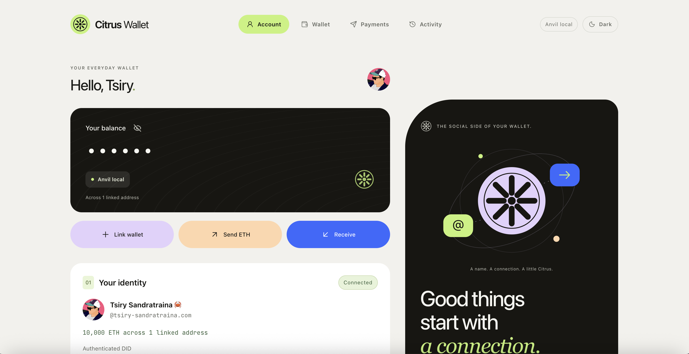

# Peachlet Wallet

[](https://github.com/tsirysndr/peachlet/actions/workflows/api-tests.yml)
[](https://github.com/tsirysndr/peachlet/actions/workflows/web-tests.yml)

Pay someone by their AT Protocol handle instead of their Ethereum address.



An Ethereum address is 42 characters of hex that nobody can check by eye, so sending ETH to a person means trusting an address copied from somewhere. An AT Protocol handle — `alice.bsky.social` — is something you already recognise. Peachlet Wallet connects the two: you prove you control an address by signing a message naming your AT Protocol account in Peachlet Wallet or optional MetaMask, and from then on people can pay you by handle.

Sending works in the open. You type a handle, the server resolves it to the account's stable DID and the address that account chose to receive on, and shows you the full address, the pinned DID, the network and the amount. Nothing moves until you approve the transaction. Built-in wallets sign on your device; MetaMask remains an optional external signer.

If the person you want to pay has not set up a receiving address yet, you create an invitation instead — a link that reserves no funds and promises nothing. They open it, sign in as the account the invitation names, link a wallet, and choose an address to share with you alone, which can stay private from everyone else. You then come back and approve the transfer as usual.

Identity is pinned when the payment is created, so a handle that later changes hands cannot redirect it, and a receiving address that changes forces you to review the payment again before it can be sent.

The server holds no keys, signs nothing, and never takes custody: there is no escrow, no deployed contract, and no automatic payout. It records the signed proofs linking accounts to addresses, keeps track of payment intents, and checks a broadcast transaction against what you reviewed. ETH and standard ERC-20 transfers on Ethereum mainnet or a local Anvil chain. Native Bitcoin is deferred.

## Local development

Requires Bun, Node.js 24+, Gleam 1.19+, and a modern browser. MetaMask is optional.

```sh
bun install
bun run dev:local
```

Open **http://127.0.0.1:5173**, using that exact origin. This starts three processes: the Vite dev server for the frontend on **5173**, the Gleam server for the API on **4747**, and Anvil (RPC `http://127.0.0.1:8545`, chain **31337** / `0x7a69`), using `data/local.sqlite`. Vite proxies `/api`, `/auth` and `/client-metadata.json` to the Gleam server, so everything stays one origin and the frontend hot-reloads. Ctrl+C stops all three. The launcher refuses to reuse an existing node on port 8545. Anvil starts fresh each run; the app's database persists.

Use the loopback IP literal, not `localhost`: AT Protocol OAuth refuses a `localhost` redirect URI ([RFC 8252](https://www.rfc-editor.org/rfc/rfc8252#section-8.3)).

To run the two halves separately, or to serve the built frontend from the Gleam server the way production does:

```sh
bun run dev:web   # frontend only, on 5173, proxying to VITE_API_URL
bun run dev       # API and the built frontend from web/dist, on 4747
```

MetaMask offers to add/switch to Anvil. For funded test accounts, import Anvil's printed development private keys into separate MetaMask test accounts. **These public development keys must never hold real funds.** Linking a wallet requires no ETH; sending requires ETH for the amount and network fees.

AT Protocol login still uses your actual account provider over the internet. The app has no mock-login route or local PDS. Use separate browser profiles to test two different AT Protocol identities. `127.0.0.1` on a phone refers to the phone, so the defaults target a desktop browser on your development machine.

### Send to an existing recipient

1. Both users sign in with their AT Protocol accounts and link a wallet on the same network.
2. The recipient checks **Allow public payments to this address** when linking. Their first public wallet on that chain becomes the receiving default. They can change it with **Make default**.
3. The sender resolves the recipient's handle, reviews the returned DID, chooses an asset, enters its amount, and creates a payment intent.
4. The sender reviews the full address, pinned DID, network, and amount, then checks the acknowledgement and selects **Review & send**.
5. Your selected wallet displays the transaction and fee. After approval, use **Refresh status** to check the transaction against the server's RPC and the required confirmations.

### Invite someone without a receiving address

1. Resolve their handle/DID and create a payment intent. It shows **Awaiting recipient setup**. No funds move or become reserved.
2. Copy the generated invitation URL and share it yourself. The app does not send messages or notifications.
3. The recipient opens it, signs in as the intended DID, links a wallet, and selects **Use this address for this payment**. The chosen address may stay private from other users; this sender can see it.
4. The sender returns to their payment history, opens the intent, refreshes its status, and reviews/approves the transfer in their selected wallet.

The invitation is **not a funded claim link** and does not promise that the sender will pay. Intents expire after seven days. Only the pinned recipient DID can accept, even if the original handle changes hands. Invitation tokens are hashed at rest; generating a new invitation invalidates the old link. URL fragments keep the initial token out of ordinary page request URLs, and the frontend preserves it in session storage across OAuth redirects.

### Handle suggestions

Both handle fields — sign-in and recipient — suggest accounts as you type: a rounded avatar (or a generated placeholder with the initial), the display name, and the `@handle`. Arrow keys and Enter pick one; Escape closes the list.

Suggestions come from an AT Protocol AppView's typeahead, called by **this server** rather than the browser, so the page keeps its `connect-src 'self'` policy and your keystrokes are not sent to a third party by the page itself. The server drops any result it would refuse to address anyway — an invalid handle, or a DID method this app does not support — and only passes through an avatar URL on an allow-listed HTTPS host, which is also the only remote host added to the page's `img-src`. Avatar images are then loaded by the browser from that CDN directly, with `referrerpolicy="no-referrer"`; anything else falls back to the placeholder.

A suggestion is a convenience, never a source of truth: picking one only fills the field. The identity is still resolved and verified in both directions through `/xrpc/app.peachlet.resolveRecipient` before a payment intent can name it.

### Signing in, or signing up

The sign-in form takes a handle or DID and hands off to that account's own provider. It also links to an explainer for people who have never heard of an atmosphere account, and offers **Create one**, which starts the same OAuth flow against the provider in `SIGNUP_PDS` with `prompt=create` so that provider shows its sign-up screen. The account is created there, not here: this app never sees a password.

### Your account

Once you are signed in, the identity panel shows who you are: a rounded avatar (or a generated placeholder), your display name, your `@handle`, your DID, and what you hold across the wallets you have linked on the active chain.

Only the DID is authoritative — it comes from the OAuth login. The name and avatar are fetched once per session from an AppView and vetted exactly like handle suggestions are, so an account the AppView does not know simply shows its DID, and a name or picture never affects what the app will accept as a payment recipient.

### Account balances

The linked-addresses panel shows balances on the selected chain. Built-in wallets read the selected RPC directly, including while locked; optional MetaMask uses its provider. Balance reads never initiate a connection or signing prompt. **Refresh balances** re-reads them.

### ERC-20 assets

Web and Expo discover ERC-20 holdings for each linked wallet, with pagination and direct contract lookup in the payment asset picker. Ethereum mainnet discovery uses Blockscout's public API; `TOKEN_INDEXER_URL` can override its HTTPS `/api/v2` base URL. Discovery can lag the chain or be unavailable, and heavily used wallets may time out. The UI reports unavailable discovery and still supports direct contract lookup. Local Anvil uses contract lookup without a public indexer.

A token is identified by its chain and contract, never its symbol. Selection reads metadata and balances from the configured Ethereum RPC. Creating an intent snapshots the token metadata; preparing it rechecks decimals, available balance, and transfer simulation. A successful receipt must contain the exact matching ERC-20 `Transfer` event before Peachlet Wallet marks it confirmed. No token approval or allowance is requested. ETH is still required for gas. Fee-on-transfer, rebasing, and other nonstandard tokens may not satisfy exact-transfer verification.

The shared `@peachlet/amounts` package in `app/packages/amounts` uses an isolated BigNumber.js configuration. Amounts remain decimal strings, atomic units remain integer strings, and excess precision is rejected instead of rounded. The clients construct the expected transfer locally and compare it with the prepared wallet request. Account balances list assets separately; amounts in different assets are never added together.

Payments store `amount_atomic`, token contract, symbol, name, and decimals. Migration `0011` preserves existing ETH amounts and assigns ETH metadata. XRPC returns `assetId`, `assetDetails`, and `amountAtomic`; `amountWei` remains a deprecated compatibility alias for atomic units. Lexicons originate in PKL; run `bun run lex:generate` after changing them.

## Database and migrations

The schema is defined in Gleam, one module per table, under `src/peachlet/drizzle/schema/`. Those modules build real Drizzle tables, so they are the single source of truth for both queries and migrations: `drizzle/schema.mjs` re-exports the compiled tables for `drizzle-kit`, which generates the SQL in `drizzle/`.

```sh
bun run db:generate   # gleam build, then drizzle-kit generate
bun run db:check
```

The server applies pending migrations at startup, so no separate migrate step is needed. There is no raw SQL in the Gleam code: every query goes through the typed Drizzle bindings in `src/peachlet/drizzle/orm.gleam`. The only SQL text anywhere is the two partial-index predicates in the schema modules, which Drizzle expresses as SQL in any language, and the three connection `PRAGMA`s in `src/peachlet/ffi/better_sqlite.gleam`.

The same Ethereum address can be independently linked on different chains, with at most one DID owning an `(address, chain)` association. Each DID has at most one public receiving default per chain.

OAuth login upserts `user_profiles` by DID, storing the handle, display name, avatar URL, and creation/update timestamps in Unix milliseconds. `id` is an automatically assigned integer primary key; `did` is unique and non-nullable, and `handle` is non-nullable. Other profile fields remain nullable. Updates preserve `created_at`; `/xrpc/app.peachlet.getProfile` also refreshes the stored profile and falls back to it when the AppView is unavailable. A first login without an available profile records the DID with an empty handle until a later successful lookup. Avatar image files are not copied into the database.

## Mainnet / configuration

```sh
bun run dev
```

This defaults to MegaETH mainnet (chain 4326), with `data/wallet.sqlite`. Ethereum mainnet and MegaETH testnet (chain 6343) remain available. Public RPC defaults are supplied for all three; override server verification endpoints with `MEGAETH_RPC_URL`, `MEGAETH_TESTNET_RPC_URL`, and `ETH_RPC_URL`. Clients receive public network endpoints, never private server overrides. Anvil RPC is configured automatically in `dev:local`.

See `.env.example`. Variables are read from the process; to explicitly load an `.env` file, export it into the environment before starting the app.

| Variable | Default / meaning |
| --- | --- |
| `APP_URL` | `http://127.0.0.1:4747`; exact origin, no trailing slash |
| `PORT`, `HOST` | `4747`, `127.0.0.1` |
| `EVM_CHAIN_ID` | `4326` by default; `1` for Ethereum; `6343` for MegaETH testnet; `31337` only with a loopback app origin |
| `ETH_RPC_URL` | Ethereum verification RPC; defaults to PublicNode |
| `MEGAETH_TESTNET_RPC_URL` | MegaETH testnet verification/fee RPC; defaults to `https://carrot.megaeth.com/rpc` |
| `MEGAETH_RPC_URL` | MegaETH verification RPC; defaults to `https://mainnet.megaeth.com/rpc` |
| `DATABASE_PATH` | `data/wallet.sqlite`, or `data/local.sqlite` on Anvil |
| `MIGRATIONS_DIR` | `./drizzle`; applied at startup |
| `PUBLIC_DIR` | `./web/dist`; the built frontend, resolved against the working directory |
| `APPVIEW_URL` | `https://public.api.bsky.app`; HTTPS or loopback, serves handle suggestions |
| `SIGNUP_PDS` | `https://selfhosted.social`; HTTPS or loopback, where **Create one** sends new users |
| `TRUST_PROXY_HOPS` | `0`; set only for your trusted reverse-proxy topology |
| `VITE_API_URL` | `http://localhost:4747`; where the dev server proxies the API. Build-time only |
| `VITE_PORT` | `5173`; the dev server's own port. Build-time only |

For HTTPS hosting, make `/client-metadata.json` publicly reachable by the user's OAuth server and use a persistent, access-controlled database volume. HTTPS enables Secure cookies and HSTS. Use a single Node process; multiple workers require shared OAuth locking, shared rate limiting, and coordinated database access.

Request rate limiting is built in: 60 requests per minute per client across `/api` and `/auth`, counted in a fixed window in the database and reported with `RateLimit-Policy` and `RateLimit` headers. Handle suggestions are metered separately, at 240 per minute, so a burst of keystrokes cannot spend the budget that payment requests need. The client address comes from the socket unless `TRUST_PROXY_HOPS` says how many proxy hops to trust, so a forwarded header cannot invent more hops than you configure.

## Payment behavior and recovery

Handles are resolved with the official identity SDK's SSRF-protected fetch. The DID document must claim the handle and match the resolved DID. A sender previews the DID; creation resolves it again and rejects a changed identity. After creation, the recipient DID is pinned. The displayed handle is a creation-time label and cannot retarget the intent.

A public default can change while an intent is awaiting preparation; this increments its revision and requires another sender review. Private invitation choices are scoped to that payment. Unlinking a receiving wallet invalidates its use for new preparation. Preparing freezes the destination and reserves a specific sender nonce in the app, so repeated preparation returns the same transaction instead of creating another send.

The sender's wallet account must be linked to their authenticated DID on the payment network. The server verifies its RPC's chain before preparation. The frontend checks the prepared transaction against the reviewed address, amount, DID, and chain, then invokes `eth_sendTransaction`. The selected wallet signs and broadcasts locally.

After broadcast, the server stores the transaction hash before making RPC checks. It validates the sender, recipient, value, empty call data, nonce, chain, and receipt status. Mainnet requires **12 confirmations**; Anvil requires **1**. Status is checked on demand with **Refresh status**. A missing transaction or RPC outage is never treated as success. Previously checked receipts are rechecked when you refresh an individual payment, so a missing receipt can return it to submitted status.

If the page loses the response after wallet approval, check your selected wallet before retrying. A broadcast hash is preserved in the current tab's session storage until the server accepts it. The review panel also lets you attach the original transaction hash manually. An unresolved wallet request blocks another send in that tab until you recover its hash or explicitly indicate that no transaction was sent. A declined wallet request can retry the same prepared intent/nonce. Preparing reserves no funds and creates no on-chain lock.

Only unprepared intents can be cancelled in the app. An expired prepared intent releases its app-level nonce reservation on subsequent preparation, while retaining its attempt metadata so an already broadcast transaction can still be reported. Expiry and cancellation are off-chain workflow states: they cannot revoke a transaction already signed/broadcast or close a wallet prompt. The wallet's final approval is authoritative; changing transaction fields in MetaMask can cause the resulting transfer to fail this app's verification.

## XRPC API and lexicons

All application API methods are under `/xrpc/app.peachlet.*`. Old `/api/*` and `/auth/start` routes are removed. Queries use URL parameters; procedures use JSON bodies, including payment IDs and invitation tokens. Errors use `{ error, message }`.

Authenticated procedures retain HttpOnly cookies, exact `Origin`, and `x-csrf-token` from `app.peachlet.getSession`. JSON bodies are limited to 8 KiB. These are browser-session APIs, not PDS-proxied bearer-token endpoints. `/auth/callback` and `/client-metadata.json` remain OAuth protocol endpoints.

`pkl/defs/` is the authoritative source. With the PKL CLI installed, run `bun run lex:generate` to evaluate PKL into `lexicons/*.json`, run the official lex-cli TypeScript generator, and emit server runtime schemas and Gleam method constants. Commit generated outputs; production builds do not require PKL. The frontend calls the generated client with cookie/CSRF handling; the server validates request and response bodies against those same schemas.

`src/peachlet/xrpc/` groups handlers into `auth.gleam`, `address.gleam`, `payment.gleam`, and `actor.gleam`. `register.gleam` registers all methods, `context.gleam` contains shared security/session helpers, and `methods.gleam` is generated.

| HTTP | NSID (append to `/xrpc/`) | Parameters / JSON fields |
| --- | --- | --- |
| POST | `app.peachlet.acceptInvitation` | `token`, `address` |
| POST | `app.peachlet.cancelPayment` | `id` |
| POST | `app.peachlet.createChallenge` | `address`, `public` |
| POST | `app.peachlet.createInvitation` | `id` |
| POST | `app.peachlet.createPayment` | `identifier`, `expectedDid`, `amount` |
| POST | `app.peachlet.estimateFees` | `chainId`, `from`, `to`, `value` (decimal wei), `data`, `nonce` |
| GET | `app.peachlet.getAddresses` | `did` |
| GET | `app.peachlet.getInvitation` | `token` |
| GET | `app.peachlet.getPayment` | `id` |
| GET | `app.peachlet.getProfile` | — |
| GET | `app.peachlet.getSession` | — |
| GET | `app.peachlet.listPayments` | — |
| POST | `app.peachlet.logout` | — |
| POST | `app.peachlet.preparePayment` | `id`, `revision`, `address`, `fromAddress` |
| POST | `app.peachlet.resolveRecipient` | `identifier` |
| GET | `app.peachlet.searchActors` | `q` |
| POST | `app.peachlet.setDefaultAddress` | `address` |
| POST | `app.peachlet.startLogin` | `identifier`, `create` |
| POST | `app.peachlet.submitPayment` | `id`, `attemptId`, `txHash` |
| POST | `app.peachlet.syncAddresses` | — |
| POST | `app.peachlet.unlinkAddress` | `address` |
| POST | `app.peachlet.verifyChallenge` | `id`, `signature` |

### Repository address records

OAuth requests `atproto repo:app.peachlet.address`: create/update/delete access only for that collection. Repository records are publicly readable. Existing browser sessions are invalidated once so users sign in again and grant collection permission. Credentials remain in the private server-side OAuth session store, with single-process refresh locking; logout removes them.

Only verified public links are published. The checkbox explicitly discloses publication. Records contain `chain` (CAIP-2, e.g. `eip155:1`), `address`, the signed `message`, `signature`, and `createdAt`. The deterministic key is `eip155-<chain ID>-<lowercase address>`. Private links and unlinking queue deletions; deleting a record cannot retract previously indexed copies.

The link mutation and persistent outbox share one SQLite transaction. PDS writes are serialized by DID, with conditional acknowledgment so concurrent edits survive. Failed writes remain queued and are retried at login or through `app.peachlet.syncAddresses`; the UI shows `addressSyncPending` and a retry action. Login also backfills public links not yet indexed from the repository. Records are locally validated and sent with `validate: false` because a PDS may not have installed our custom lexicon.

### Jetstream indexing

The API starts concurrent listeners for four production URLs across US East and US West defined by `JETSTREAM_URLS` in `src/jetstream.mjs`. The environment variable **`JETSTREAM_URLS` overrides the entire list**, using comma-separated WSS URLs. `JETSTREAM_ENABLED=false` disables listeners for local/offline development. Defaults use the four live-verified `/subscribe` endpoints; the newer JSON XRPC subscription URLs are also supported.

Each connection has its own durable cursor and reconnect backoff. `address_repository_records` stores the latest repository revision per DID/rkey, including deletion tombstones. This deduplicates overlapping streams and replays across restarts and prevents old records from reviving deleted addresses. The cursor and projection commit together. Queue pressure or database/profile failures reconnect from the last saved position. Multiple endpoints improve coverage but cannot guarantee recovery beyond upstream replay retention; a full historical archive import is not included.

Create/update events must pass lexicon and SIWE verification, including the record DID, wallet address, chain, app origin, and signature. Invalid updates withdraw the previous public mapping. Delete events remove the corresponding public mapping; private links and pending local changes are protected. Listener changes do not enqueue repository writes, avoiding feedback loops. Unknown DIDs are fetched through the existing AppView profile service and upserted on unique `did`, preserving `id` and `created_at`; temporary lookup failures use a DID placeholder and retry on future events.

The implementation follows the official [Jetstream subscription and cursor documentation](https://bsky.network/docs/jetstream/) and [AT Protocol repository permission specification](https://atproto.com/specs/permission). Jetstream is a trusted indexing feed, not cryptographically verified repository proofs.

## Validation and Foundry workspace

```sh
bun run check     # gleam check, then tsc on the frontend
bun run test
bun run build     # vite build, then gleam build
bun run start
```

`bun run test:web` runs the Vitest component suite with React Testing Library and MSW. Use `bun run test:web:watch` while developing. Every component has a directory containing its implementation, colocated test, and public index. See [frontend testing](web/src/test/README.md) for provider setup, fixtures, and request overrides. The full `bun run test` command includes this suite.

The backend tests cover identifier and amount validation, network configuration, the expiring key/value table, challenge issuance, link listing and receiving defaults, payment creation and pinning, invitation scoping and rotation, cancellation, preparation without an RPC, suggestion vetting and avatar allow-listing, and rate limiting, using an in-memory database migrated by drizzle-kit and an injected identity resolver.

`foundry.toml` reserves the `contracts/` workspace and an `anvil` RPC alias. Anvil is included as a dev dependency. For future Solidity work, install the full [Foundry toolchain](https://getfoundry.sh/introduction/installation/) and add contracts/tests before running `forge build` / `forge test`. Wallet linking and these payments need no deployed contract.

## Implementation

The server is written in Gleam, compiled to JavaScript and run on Node.js, with Hono, the official AT Protocol OAuth and identity SDKs, viem, Drizzle ORM over SQLite, and Foundry Anvil for local development.

Every dependency binding is written in Gleam. `src/ffi.mjs` is the only JavaScript on the server: a generic bridge for the few constructs Gleam cannot express (property access, method calls, `new`, object literals, thrown exceptions, BigInt, mutable cells). It contains no application logic and knows about no package.

The frontend is a React single-page app in TypeScript, built by Vite: Tailwind CSS for styling, TanStack Router for its four screens, TanStack Query for everything read from the server, Jotai for the state that is only the page's own, and React Hook Form with Zod for every input. Zod mirrors the server's own rules so a typo is caught before a request is made, never instead of one — the server validates everything it receives. Roboto Mono Variable is bundled and served from this origin, so the page loads no third-party font; addresses, handles, balances and amounts use the same monospace family.

The layout is mobile-first: one column with a bottom tab bar on a phone, and a wider layout with the same sections in the header on a desktop. `web/public/theme.js` is the one classic script on the page, resolving the light or dark preference into a `data-theme` attribute before the first paint; the content policy forbids inline scripts, so it cannot live in the document. Client routes are served the built document by name, so a reload or a shared link to a screen works, while a mistyped API path stays a JSON 404.

## Source and trust model

- `src/peachlet.gleam`: startup, configuration, and shutdown.
- `src/peachlet/app.gleam`: HTTP routes, sessions, CSRF, host and rate-limit middleware.
- `src/peachlet/oauth.gleam`, `src/peachlet/identity.gleam`: official OAuth client and bidirectional identity resolution.
- `src/peachlet/directory.gleam`: AppView handle suggestions, vetted before they reach the page.
- `src/peachlet/linking.gleam`: SIWE challenges, verification, wallet ownership, and receiving defaults.
- `src/peachlet/payments.gleam`, `src/peachlet/chain.gleam`: unfunded intents, recipient invitations, preparation, and RPC verification.
- `src/peachlet/store.gleam`, `src/peachlet/drizzle/`: schema, migrations, typed queries, and session state.
- `src/peachlet/network.gleam`, `src/peachlet/validate.gleam`, `src/peachlet/rate_limit.gleam`, `src/peachlet/error.gleam`: chain configuration, input shapes, request limits, and failures.
- `src/peachlet/ffi/`: Gleam bindings for Hono, Drizzle, better-sqlite3, viem, the AT Protocol SDKs, Node, `fetch`, and `URL`.
- `web/src/`: the React frontend — `pages/` for the four screens, `components/Name/` for each panel or primitive module, its index, and colocated tests, `queries.ts` for server state, `atoms.ts` for page state, `validation.ts` for the input schemas, `wallet.ts` for MetaMask.
- `vite.config.ts`: the frontend build, and the dev proxy to `VITE_API_URL`.
- `scripts/`: Anvil + app launcher.

The wallet signature proves that the Ethereum account signed a message naming the DID. DID-owner consent relies on this app's OAuth verification; a copied wallet signature alone is not an independently verifiable DID-owner attestation. Payment resolution uses the verified database projection, which now also indexes public PDS records through Jetstream; a record must pass proof verification before it becomes a receiving address. Consumers trust this server's mapping and configured RPC. Handle suggestions additionally trust the configured AppView for discovery only, and loading a suggested avatar reveals the viewer's IP address to that image CDN; neither affects what the app will accept as a payment recipient.

OAuth requests base AT Protocol access and write access to the `app.peachlet.address` collection. OAuth credentials are retained server-side for record synchronization. Browser sessions and temporary OAuth state are sensitive; keep the SQLite files private. Wallet keys, seed phrases, and transaction-signing credentials never reach the server.

Supported assets/wallets: native ETH and standard ERC-20 transfers on MegaETH and Ethereum, plus local Anvil development. Contract wallets/ERC-1271, escrow, automatic payouts, native Bitcoin, and server-managed recovery are outside this implementation. Real provider login, device biometrics, and external wallet prompts require platform testing.

The optional MetaMask installation prompt appears in the wallet panel when MetaMask is not detected, linking to the official Chrome Web Store listing. `web/public/metamask.png` is the logo from that listing, served locally. Light mode is the default even for old saved dark-mode preferences, and the theme switcher is hidden.


## Payment descriptions and activity

Payment creation accepts an optional `description` (up to 500 characters, with a 2,000-byte API limit). It is trimmed, blank values become NULL, and migration 0004 adds a nullable column without modifying old payment data. Descriptions are internal to Peachlet Wallet, visible only to payment participants, and never included in repository records or transaction data.

`app.peachlet.listPayments` lists both sent and received payments for the authenticated DID. It accepts `q`, `direction` (`all`, `sent`, `received`), `status`, `after`, `before`, `sort` (`newest`, `oldest`), `page`, and `pageSize` (1–50). The response includes `payments`, `total`, `page`, and `pageSize`. Date bounds are inclusive Unix milliseconds encoded as decimal **strings** to avoid the XRPC client's 32-bit integer serialization. Search uses FTS5 trigram indexes for literal substrings across descriptions, handles, names, DIDs, wallet addresses, and transaction hashes. Queries of fewer than three characters use a participant-scoped substring fallback. Search text is bound and quoted as a literal phrase, so punctuation and FTS operators never change query semantics. Filtering and stable creation-time/ID sorting happen in SQLite before pagination. Expiration is accounted for in status filters.

The activity UI debounces search by 300ms, cancels superseded requests, resets pagination when filters change, and offers transaction type/status filters, active-filter chips, and a themed date-range dialog. Presets include all time, last 7/30/90 days, this/last month, and this/last year. Date ranges use the viewer's local calendar. Profiles and rounded avatars are included in responses; unknown profiles are fetched through the vetted AppView lookup, with a cached fallback.

Recipients can read their incoming payment details, but only senders can prepare, submit, cancel, or generate invitations. `app.peachlet.deletePayment` permanently deletes only a sender-owned cancelled intent without a transaction hash. The UI confirms deletion; it removes the shared intent, not an on-chain transaction. Other payment states remain protected.

## Installable web app

The production frontend registers `/sw.js` and exposes `/manifest.webmanifest`, PNG icons derived from the Peachlet Wallet logo, an Apple touch icon, and an install control in the footer. Supported browsers show a native install prompt; other browsers get installation instructions. The built-in encrypted wallet works in the PWA; MetaMask is optional.

The service worker only caches the static offline page and its public assets. It does **not** cache authenticated responses, wallet data, avatars, OAuth requests, or payment requests, and never queues transfers. Offline navigation shows a reconnect screen. Updates wait for existing windows to close instead of reloading an in-progress payment. The sign-in form includes a local, animated Atmosphere app-logo strip, with pause and reduced-motion support.

### KLIPY payment attachments

Set `VITE_KLIPY_API_KEY` in `.env.prod` before `bun run build` (or in `.env` for local development). Vite exposes this public client key in the browser bundle; `.env.prod` stays ignored. The usual `.env.production` and shell settings take precedence. Production must have the same setting at build time.

The description editor offers GIF, sticker, meme, and clip search through KLIPY, with trending results, debounced search, pagination, previews, and removal. One optional `media` object accompanies the separate 500-character description. Migration `0005` adds its nullable database column. Only sender and recipient can read it; no description or attachment is published on-chain or to AT Protocol. Media loads directly from KLIPY and is excluded from the offline service-worker cache. Clips play only on user request. A random browser-local identifier is used for KLIPY discovery/share events; no DID, handle, amount, recipient, or description is sent to KLIPY.

Activity keeps search and a filter icon above the list. Transaction type, status, date range, sorting, and page size live in a responsive side drawer. Reset preserves the current search; the icon indicates active filter settings.

### Database query indexes

Migration `0006` replaces the older activity indexes with participant/chain/date/id indexes and participant/chain/status/date/id indexes. This covers both sent and received history, date filtering, status filtering, and stable ascending or descending pagination. It also indexes session/expiry cleanup, ordered wallet lists, the latest non-deleted address record revision, and expiry of prepared payment reservations. Existing primary keys and uniqueness indexes continue to cover payment IDs, invitation tokens, transaction hashes, nonce reservations, profile DIDs, wallet ownership, and Jetstream deduplication.

Activity searches of at least three characters use the FTS5 indexes introduced in migration `0007`. Shorter searches inspect candidate payment text and use correlated, indexed DID lookups for profile names. Combined sent-and-received history can still require sorting the two indexed result sets, and exact counts/deep offset pagination scale with the user's matching history. Adding an index to every text column would not remove these costs.

`test/indexes.test.mjs` checks the actual generated count/page SQL with `EXPLAIN QUERY PLAN` over 12,000 payments, verifies maintenance lookup plans, and checks that the index migration preserves records and uniqueness constraints.

### Desktop keyboard shortcuts

The floating keyboard button opens the shortcut guide. Press `G`, then `A`, `W`, `P`, or `H` to open Account, Wallet, Payments, or Activity. `/` or `Cmd/Ctrl+K` opens the quick activity search modal for signed-in users; `?` opens the guide. Native Escape closes dialogs and calendar arrow keys continue to work. Navigation shortcuts ignore text fields, editable content, active dialogs, modifier combinations, and IME composition. They are disabled on mobile/touch layouts; desktop users can also turn them off in the guide.

### MetaMask on mobile

Phones and tablets offer **Connect MetaMask** through the official MetaMask
Connect EVM client. Connections open the mobile app using a native deep link;
return to Peachlet Wallet after approving the connection, linking signature, or payment.
If unlocking does not show the connection prompt, return to Peachlet Wallet and use
**Open MetaMask again** to reopen the same pending request.
The MetaMask in-app browser continues to use its injected provider, and desktop
browsers continue to use the extension. Device hints choose the UI; Peachlet Wallet does
not claim it can inspect which apps are installed. A download link is available
in the wallet card if MetaMask is missing.

The SDK loads only for an explicit mobile connection, with analytics disabled.
Mobile balance reads use the public mainnet RPC at `https://ethereum-rpc.publicnode.com` and
connections use MetaMask’s WebSocket relay. The CSP permits HTTPS RPC connections and the MetaMask relay. Background balance reads never initiate a connection or app handoff.
After a page reload, tap Connect MetaMask to resume the SDK session. Account and
chain checks, signed ownership challenges, and payment broadcast recovery apply
to both app and extension connections.

### Activity search indexes

Migration `0007_activity_fts.sql` creates external-content FTS5 trigram indexes for payments and user profiles, then backfills existing rows. SQLite triggers maintain them on inserts, indexed-field updates, and deletes in the same transaction as the source writes. Profile edits immediately affect searches of older payments without rewriting payment rows. Both the activity screen and global search use the same `listPayments` query; participant, chain, date, and status restrictions apply before counting and pagination.

FTS virtual tables and triggers live in this custom migration because Drizzle's table schema does not represent them. Future migrations that rebuild `payments` or `user_profiles` must recreate their FTS triggers and rebuild the corresponding index. The first startup after this migration indexes existing records and may take longer on large databases. `test/activity-fts.test.mjs` covers backfill, synchronization, rollback, literal searches, privacy, and pagination; `test/indexes.test.mjs` verifies indexed query plans.

### Native app and payment notifications

The Expo app lives in [`app/`](app/README.md). It shares API contract types with the web client and uses Jotai, TanStack Query, NativeWind and MetaMask deep links.

Native login starts at `/auth/native/start` and redeems a one-time proof-bound code via `app.peachlet.exchangeNativeSession`. Native tokens use a separate server namespace from browser sessions. Browser CSRF checks stay enabled; the code-redemption endpoint uses the verifier proof, while authenticated native calls use explicit bearer credentials.

Migration `0008` creates a durable recipient notification log, push-device registrations and push delivery jobs. SQLite triggers add one notification per confirmed payment/recipient in the same transaction as confirmation. A worker checks submitted/confirming transactions in the background, so notification creation does not depend on a user polling the payment screen. Existing confirmed history is not replayed as new notifications when migrating.

The authenticated `app.peachlet.subscribeNotifications` SSE endpoint supports `Last-Event-ID` or a `cursor`, heartbeats, replay, bounded batches, per-session connection limits, and session revocation/expiry. `listNotifications` returns the latest 50 notifications and unread count; `markNotificationRead` is recipient- and chain-scoped. Both clients invalidate cached activity/balances on new events. Caddy should stream the endpoint without response buffering; the API emits `X-Accel-Buffering: no` and `Cache-Control: no-store`.

`registerPushToken` and `unregisterPushToken` manage Expo device tokens. Logout unregisters devices associated with that session. The worker queues unseen events from the last seven days, persists delivery tickets, checks Expo receipts, retries transient errors with backoff, and removes `DeviceNotRegistered` tokens. Delivery is at-least-once across ambiguous network failures; notification IDs support client deduplication. `EXPO_ACCESS_TOKEN` can be configured on the server if Expo enhanced push security is enabled. FCM v1 (Android) or APNs (iOS) credentials must also be configured on the dedicated Peachlet Wallet EAS project. No wallet keys, payment amounts or profile details are included in push bodies.

Browser Web Push is opt-in from the notification popover. `getWebPushConfig`, `registerWebPush`, and `unregisterWebPush` manage browser subscriptions with normal session/CSRF protections. The service worker displays a generic payment alert and opens a local payment page on click; it does not cache payment data. Chrome, Firefox and Safari push-service endpoints are allowlisted to prevent arbitrary outbound requests. Expired subscriptions are removed on HTTP 404/410. Signing keys are generated once and stored server-side in the database, so database backups preserve existing subscriptions. An explicit `WEB_PUSH_PUBLIC_KEY` / `WEB_PUSH_PRIVATE_KEY` pair can override them; rotating keys requires browsers to subscribe again. Only the public key is exposed to clients.

Notification queries, validation, queue processing, retry policy, and background payment checks live in Gleam (`notifications`, `notification_worker`, and `web_push`). `notification_transport.mjs` contains only library, crypto, scheduler and SSE transport bindings. `markAllNotificationsRead` clears unread state only for the current recipient and chain. The web bell shows a red unread counter and opens a scrollable popover with individual and bulk read actions.


### Built-in self-custody wallets

Create a 12-word BIP-39 wallet or import an English recovery phrase/private key from the Wallet screen. Recovery uses the first Ethereum account (`m/44'/60'/0'/0/0`); extra BIP-39 passphrases and additional derivation paths are not supported. The same address works on each EVM network, but funds stay on their original network. New wallets confirm three randomly selected recovery words using tap-to-select choices, with the other nine words prefilled. No typing is needed.

The shared `app/packages/wallet-core` uses viem accounts, scure BIP-39, and Noble AES-256-GCM/PBKDF2-SHA256 (600,000 iterations). Browser storage contains a versioned encrypted vault with fresh random salt and nonce; the password must have at least 12 characters. WebAuthn PRF can protect a second encrypted copy when the platform authenticator supports it, with required user verification. Touch ID/device PIN availability depends on the OS, browser, and authenticator; password unlock remains available. This is local wallet unlock, not server authentication.

Expo offers device unlock or a wallet password (at least 12 characters). On Android 11+, device unlock uses the existing screen-lock PIN, pattern, password, or strong biometrics through react-native-keychain with an authentication-required AES-GCM Android Keystore key. Android grants a five-second key-use window after system authentication; Peachlet Wallet never receives the screen-lock PIN. Devices without supported screen-lock authentication use password protection. Password vaults use a random device-stored secret plus the chosen password for key derivation and increasing delays after failed attempts. Existing Peachlet Wallet PIN vaults remain readable and can be upgraded from Settings after authenticating the old vault. Device migration verifies the new protected copy before replacing the old vault. Wallets lock on backgrounding and after five minutes without wallet actions; logout locks without deleting the backup or vault. JavaScript strings cannot be reliably zeroized: lock removes application references, not a guarantee of physical memory erasure.

Secrets never enter API requests, React Query, telemetry, or public AT Protocol records. Keep the recovery backup offline: clearing browser data, uninstalling, losing the device, or losing the password/PIN can make the local vault inaccessible. Peachlet Wallet cannot reset a wallet password or recover funds. Browser self-custody also relies on the integrity of the served application and device; this implementation has not received an independent security audit.

Network settings select MegaETH mainnet, MegaETH testnet, or Ethereum, with optional HTTPS RPC overrides verified against `eth_chainId`. Custom RPCs run only on the client; API verification uses fixed server-configured RPCs. Existing production environments with explicit `EVM_CHAIN_ID=1` retain that setting until it is changed. Background confirmation checks cover both mainnets and MegaETH testnet. MegaETH testnet discovers standard ERC-20 contracts from incoming Transfer logs on its public RPC, then reads metadata and current balances on-chain; results are paginated in batches of 20 contracts. RPC errors are reported as unavailable rather than an empty portfolio. Tokens without standard Transfer events can still be added by contract address. Signing preserves the server-reserved nonce, verifies sender/chain, estimates fees, requires confirmation, and aborts if the wallet locks before broadcast.


### Network fee estimates

Built-in wallets on web and Expo call `app.peachlet.estimateFees` before payment approval. The authenticated sender must be linked on the selected chain; the body's `chainId` must match `x-peachlet-chain-id` (or the server default). The Gleam handler accepts bounded ETH and ERC-20 transfer requests, verifies the server RPC's chain ID, and asks that RPC for EIP-1559 fees and `eth_estimateGas` using the exact sender, destination, value, calldata, and reserved nonce. Ethereum (1) and MegaETH (4326) never share a fixed gas limit. MegaETH estimates therefore include its chain-specific compute and storage costs.

Responses echo the transaction and return `gasLimit`, `maxFeePerGas`, `maxPriorityFeePerGas`, and `maxFeeWei` as decimal integer strings, plus `expiresAt` in Unix milliseconds. Quotes expire after 60 seconds. Both clients validate the transaction binding and fee arithmetic, display the maximum execution fee, and recheck expiry after approval. A stale quote or failed simulation stops signing; there is no fixed-gas fallback. Custom RPCs remain client-only for broadcasting; server estimates use `ETH_RPC_URL` / `MEGAETH_RPC_URL` / `MEGAETH_TESTNET_RPC_URL`. MetaMask continues to manage its own gas estimation. This endpoint never receives private keys, signs, or broadcasts. Deploy the API before distributing clients that require this endpoint.

Token picker logos use chain-and-contract mappings generated from the Uniswap and official MegaETH token lists by `node scripts/token-logos.mjs`. Missing or failed logos use a circular symbol fallback. Logos do not establish token authenticity.


## Peachlet Wallet transition

The public origin is `https://peachlet.app`, the application namespace is `app.peachlet.*`, and native links use `peachlet://`. Set production `APP_URL=https://peachlet.app` and `EXPO_PUBLIC_API_URL=https://peachlet.app`; configure DNS and Caddy for that host before switching clients. The systemd definition is `systemd/peachlet.service`. Its working directory intentionally retains the existing server checkout location. Stop the old service before enabling the renamed service on the same port. GitHub repository links point to `tsirysndr/peachlet`.

Keep the existing database and secrets. Accounts, payments and local links stay in that database. OAuth consent must be renewed to grant access to `app.peachlet.address`. Old public records are not rewritten or deleted automatically; re-link public addresses under the new origin to sign a fresh proof and publish in the new collection. Existing records do not count as published in the new namespace. Old clients using `app.citruswallet.*` must upgrade.

Wallet encryption format identifiers and existing local storage keys are intentionally retained for compatibility. Browser storage and passkeys cannot move between domains: recover the wallet on the new domain with its recovery phrase/private key and configure device unlock again. The new Android package `app.peachlet` installs separately and cannot access the previous application's secure storage; keep the old application until recovery is verified.

Before an Android release, register `app.peachlet` in Firebase and download its `google-services.json`. Configuration for the previous package is excluded from builds. The existing Expo project is displayed as Peachlet Wallet; its internal slug and project ID remain stable to preserve the project and push credentials. Verify the new package's signing fingerprint in the Android asset-links response. These external project, DNS and deployment changes are not performed by editing the repository.
